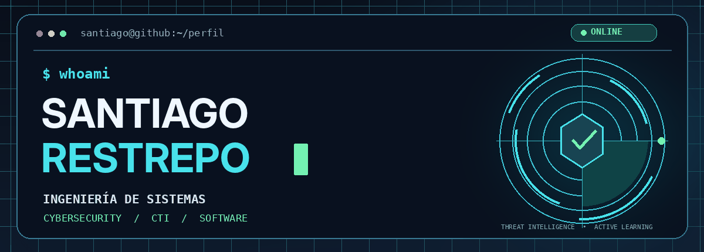
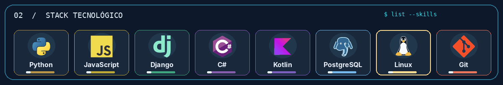
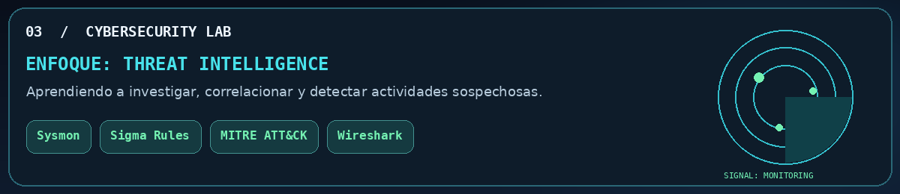
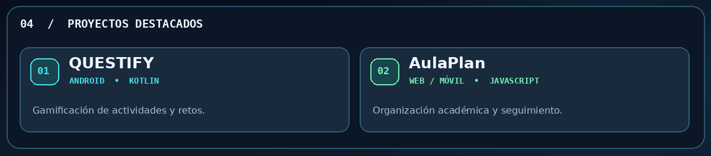

<!-- PERFIL DE GITHUB · SANTIAGO RESTREPO · CYBER TECH V3 -->

<div align="center">
  

  <p>
    <strong>Ingeniería de Sistemas</strong> · Ciberseguridad · Cyber Threat Intelligence · Desarrollo de software
  </p>
</div>

### `01 / SOBRE MÍ`

Soy estudiante de **Ingeniería de Sistemas**. Me interesa la **ciberseguridad**, especialmente el análisis de amenazas (*Cyber Threat Intelligence*), la detección de comportamientos sospechosos y la investigación de eventos de seguridad.

También disfruto desarrollar aplicaciones, experimentar con nuevas tecnologías y trabajar en proyectos que solucionen problemas reales.

```bash
$ cat perfil.txt
rol         : Estudiante de Ingeniería de Sistemas
intereses   : CTI | Detección de amenazas | Desarrollo de software
actualmente : Aprendiendo, investigando y construyendo
ubicacion   : Colombia
```

<br>

<div align="center">
  

</div>

<br>

<div align="center">
  
</div>

**Áreas que estoy explorando:**

- **Análisis y correlación de eventos:** Sysmon, registros de Windows e hipótesis de investigación.
- **Detección de amenazas:** reglas Sigma y análisis de patrones sospechosos.
- **Threat Intelligence:** indicadores, contexto de amenazas y marco MITRE ATT&CK.
- **Análisis de tráfico y laboratorios:** Wireshark, Linux y entornos de práctica.

<br>

<div align="center">
  
</div>

| Proyecto | Descripción | Tecnologías |
|:--|:--|:--|
| **[QUESTIFY](https://github.com/santiagorestrepo14/QUESTIFY)** | Aplicación Android de gamificación con retos, niveles y uso de sensores. | Kotlin · Jetpack Compose |
| **[AulaPlan](https://github.com/santiagorestrepo14/AulaPlan-App)** | Aplicación para organizar materias, actividades y seguimiento académico. | JavaScript · SASS · Vite · Capacitor |

<br>

### `05 / EN CONSTRUCCIÓN`

Mi objetivo es seguir fortaleciendo mis habilidades de desarrollo de software y construir un portafolio de prácticas documentadas en ciberseguridad y **Cyber Threat Intelligence**.

<div align="center">
  <p><code>$ echo "Siempre aprendiendo. Siempre construyendo."</code></p>
  <a href="https://github.com/santiagorestrepo14">
    
  </a>
</div>
