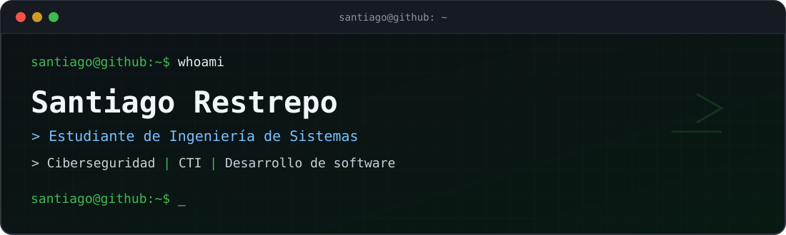

<div align="center">



<br />


</div>

### `santiago@github:~$ whoami`

Soy **Santiago Restrepo**, estudiante de **Ingeniería de Sistemas**. Me interesan la **ciberseguridad**, la **inteligencia de amenazas (Cyber Threat Intelligence, CTI)** y el **desarrollo de software**.

Busco conectar lo que aprendo sobre análisis y detección de amenazas con la construcción de herramientas y aplicaciones útiles. Actualmente continúo formándome en seguridad ofensiva y defensiva mediante ejercicios y laboratorios académicos.

### `santiago@github:~$ cat intereses.txt`

```text
[01] Inteligencia de amenazas y análisis de indicadores (CTI)
[02] Detección de actividad sospechosa y análisis de registros
[03] Seguridad de sistemas, redes y entornos de laboratorio
[04] Desarrollo backend, frontend y aplicaciones móviles
[05] Automatización y aprendizaje continuo
```

### `santiago@github:~$ ls ~/tecnologias/`

**Desarrollo**


**Herramientas y entornos**


### `santiago@github:~$ tree ~/proyectos/`

```text
proyectos/
├── QUESTIFY/     # Gamificación para Android
└── AulaPlan/     # Organización académica multiplataforma
```

| Proyecto | Descripción | Tecnologías |
| :--- | :--- | :--- |
| **[QUESTIFY](https://github.com/santiagorestrepo14/QUESTIFY)** | Aplicación Android que convierte actividades cotidianas en desafíos, logros y niveles; aprovecha sensores del dispositivo. | Kotlin, Jetpack Compose |
| **[AulaPlan](https://github.com/santiagorestrepo14/AulaPlan-App)** | Aplicación híbrida para organizar materias, actividades, calendario y seguimiento de notas. | JavaScript, SASS, Vite, Capacitor |

### `santiago@github:~$ tail -f aprendizaje.log`

```text
[EN CURSO] Correlación y análisis de eventos con Sysmon
[EN CURSO] Reglas de detección con Sigma
[EN CURSO] Investigación de actividad sospechosa en Windows
[EN CURSO] Metodologías de análisis y respuesta ante amenazas
```

> Este apartado refleja áreas que estoy **estudiando y practicando**, no certificaciones ni experiencia laboral declarada.

### `santiago@github:~$ cat contacto.txt`

Puedes explorar mis repositorios o contactarme a través de mi perfil de GitHub:

[](https://github.com/santiagorestrepo14)

---

<div align="center">
  <sub><code>status: aprendiendo · investigando · construyendo</code></sub>
</div>
